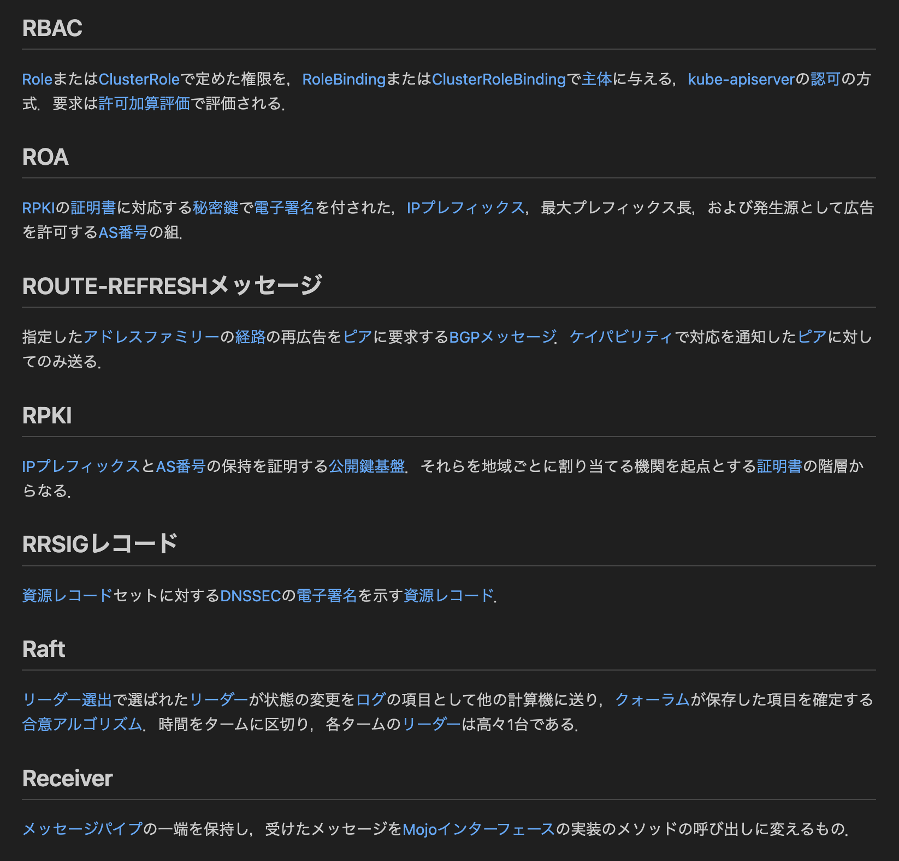
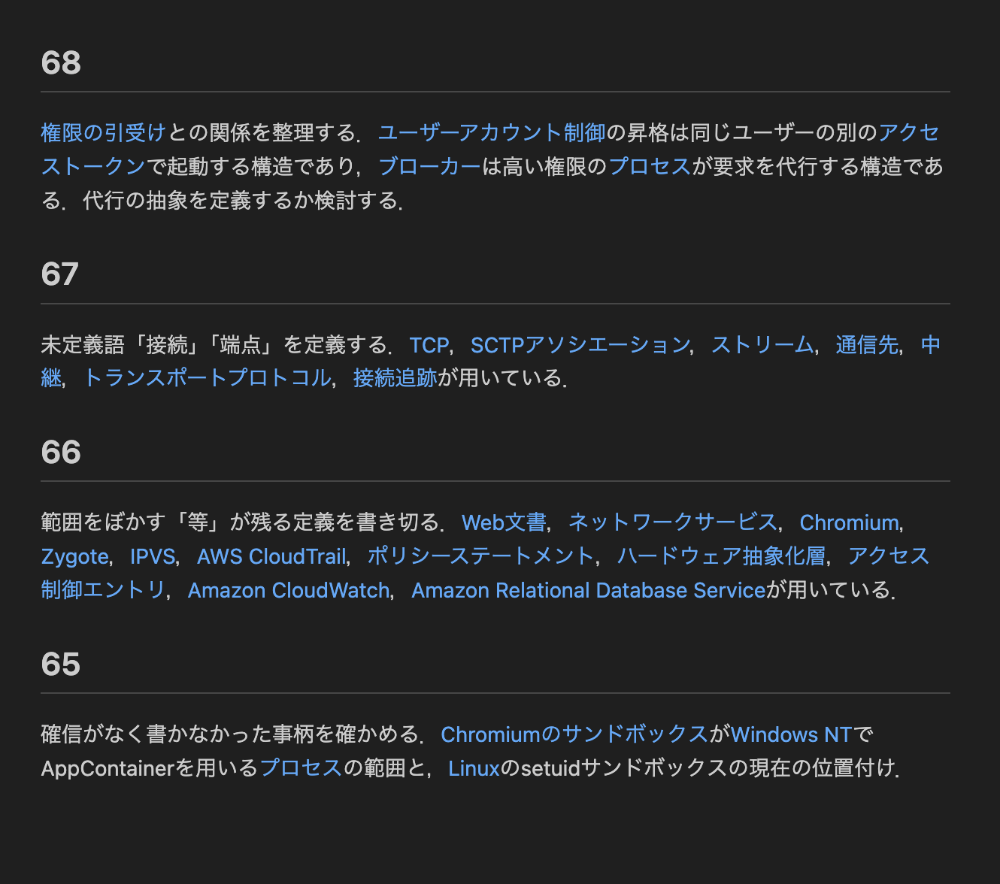

日本語 | [English](README.en.md)

# defwiki

defwikiは，AIエージェント専用のナレッジベースを提供するMCPサーバです．人間が読むことは主目的としていません．
記述を用語集の形式に制限することで，AIエージェントが持続的にナレッジベースを構築できます．

人間が中身を確認するときは，`defwiki-export`スクリプトでMarkdownに書き出します．以下は，そうして書き出したサンプルです．
- [examples/wiki.md](examples/wiki.md): AIの生成した，941個の定義からなるWikiです．
- [examples/todo.md](examples/todo.md): AIの生成した，Wikiに対するToDoリストです．

以下は，サンプルのスクリーンショットです．
ToDoリストでは，AIエージェントが自律的にWikiの修正・似た構造の概念の抽象化を試みていることが分かります．

<p align="center">
  
  
</p>

MCPサーバの仕様は[SPEC.md](SPEC.md)に，エージェントが従う運用規則は[src/defwiki/rules.md](src/defwiki/rules.md)にあります．

## 設計方針

defwikiは「最小の記述で最大の説明を」を原則とします．
自由形式のナレッジベースには次の欠点があります．

- 分量が増え続け，人間もAIも全容を把握できなくなる．
- 知識同士の関係が明示されないため，AIエージェントが既存の知識の上に新しい知識を「積み上げる」ことができない．

defwikiはこれを防ぐため，次の制約を設けます．

- 記述を用語集の形式に制限する．知識は定義同士の参照で結び付くので，既存の定義の上に新しい定義を書ける．1つの概念は1つの定義にだけ書かれ，他の箇所はそれを参照する．これは知識に対するDRY原則にあたる．
- 「閉じた体系」として外部への依存をなくす．説明は外部のドキュメントを参照せず，Wiki内の定義だけで完結させる．
- 概念を文書内の位置や順序に依存しない「定義」として扱い，他の文脈へ持ち出せるようにする．

以上の方針のもと，defwikiはWiki(用語集)とToDoリストの2つを持ちます．

## Wikiについて

Wikiは順序を持たない定義の集合です．定義は「識別子」「用語」「説明」からなります．
次の例は，トークン，モデル，コンテキストの定義を表します．

```markdown
# [[k3f9x2]] トークン
[[p8m2qa|モデル]]が処理する文字列の単位．

# [[p8m2qa]] モデル
[[w7d4ne|コンテキスト]]を受け取り，次の[[k3f9x2|トークン]]を予測する関数．

# [[w7d4ne]] コンテキスト
[[p8m2qa|モデル]]が一度に受け取る[[k3f9x2|トークン]]の列．
```

識別子はMCPサーバがランダムに割り当てる`[a-z0-9]`の6文字です．説明の中では，他の定義を`[[識別子|用語]]`の形式で参照します．

`create`では，複数の定義を一括作成できます。同じ呼び出しで作る定義は`[[用語]]`で参照するため，循環参照も記述できます。一括作成内では用語の重複を禁止しますが，既存の定義と同じ用語は使えます。

```json
{
  "defs": [
    {"term": "モデル", "description": "[[トークン]]を予測する関数．"},
    {"term": "トークン", "description": "[[モデル]]が処理する文字列の単位．"}
  ]
}
```

`[[用語]]`は今回作る定義だけを参照し，既存の定義は検索しません。既存の定義への参照，取得結果，`update`やToDoでは`[[識別子|用語]]`を使います。`[[識別子|用語]]`の形は常にIDによる参照として解釈します。

## ToDoリストについて

ToDoリストはAIエージェントが参照・更新する，順序付きのリストです．defwikiがToDoリストを含むのは，その場で直さない問題を，作業をまたいで持ち越すためです．
AIエージェントは，作業中に気づいたそうした問題を，ToDoとして先頭に追加します．
ToDoは番号と本文からなり，本文は説明と同じく`[[識別子|用語]]`の形式で定義を参照できます．
作業の冒頭でToDoリストを見て，片付くToDoを先に処理して消し，手を付けないToDoは末尾に送ります．

## 運用規則について

defwikiは，データ形式に加えて，AIエージェントが従う運用規則を提供します．形式の制約だけでは設計方針を守れないためです．

用語集の形式は，記述を定義の集合に限定します．しかし，何を定義とし，どう書くかは決めません．規則なしに書き込むと，重複する定義，曖昧な説明，一時的な情報が溜まり，自由形式のナレッジベースと同じ欠点が生じます．

運用規則は，次の判断をエージェント間で揃えます．

- 何を書くか: 確信のある恒久的な知識のみを，範囲と条件を書き切って書く．
- どう書くか: 既存の定義を参照し，抽象化によって説明の量を最小にする．
- いつ直すか: 気付いた問題をその場で直すか，ToDoに積む．

規則の一部は`check`で機械的に検査されます．意味の重複や抽象化の余地は機械で検出できないため，その判断を規則としてエージェントに委ねます．規則は`rules`ツールでエージェントに渡されます．

## 導入

### 依存関係

- Python 3.10以上
- [uv](https://docs.astral.sh/uv/)

### 手順

リポジトリを取得し，そのディレクトリで依存関係をインストールします．

```bash
git clone https://github.com/myaccount-hash/defwiki.git /path/to/defwiki
cd /path/to/defwiki
uv sync
```

MCPクライアントに`defwiki`コマンドを登録します．Claude Codeでは次の通りです．

```bash
claude mcp add defwiki -- uv run --directory /path/to/defwiki defwiki
```

設定ファイルに書く場合は次の通りです．

```json
{
  "mcpServers": {
    "defwiki": {
      "command": "uv",
      "args": ["run", "--directory", "/path/to/defwiki", "defwiki"]
    }
  }
}
```

登録後，AIエージェントがdefwikiを使うようシステムプロンプトを設定します．例えば次のように書きます．

```
新しい知識を保存するとき，および知識を参照するときは，defwiki MCPを使用すること．
```

### データベースの場所

WikiとToDoリストは1つのデータベースファイルに保存されます．場所は環境変数`DEFWIKI_DB`で指定します．既定は`~/.defwiki/wiki.db`です．`defwiki-export`も同じ場所を読みます．

## 中身の確認

`defwiki-export`は，Wiki全体を`wiki.md`に，ToDoリスト全体を`todo.md`に書き出します．書出し先は`--out-dir`で指定します．既定は`exports`です．
どちらも，参照をクリック可能なリンクに変換したMarkdownです．描画すると識別子は表示されません．`todo.md`内の参照は`wiki.md`の定義へリンクし，`wiki.md`の各定義の末尾には，その定義を参照しているToDoへのリンクが並びます．

```bash
uv run defwiki-export --out-dir exports
```

## ライセンス

[MIT](LICENSE)